# ApnaPay

ApnaPay is a Flutter mobile wallet demo for exploring common digital payment experiences. The app includes onboarding, wallet, money transfers, mobile top-ups, bill payments, QR, and transaction history screens.

> **Demo application:** Features and payment flows are for demonstration. Do not use real financial, identity, or card information. The project does not represent a production payment service unless separately integrated with verified backend providers.

## Screenshots

The screenshots below use the numbered image files already included in the repository. They are shown in order from `1.jpg` through `13.jpg`.

| 1 | 2 | 3 |
| --- | --- | --- |
| 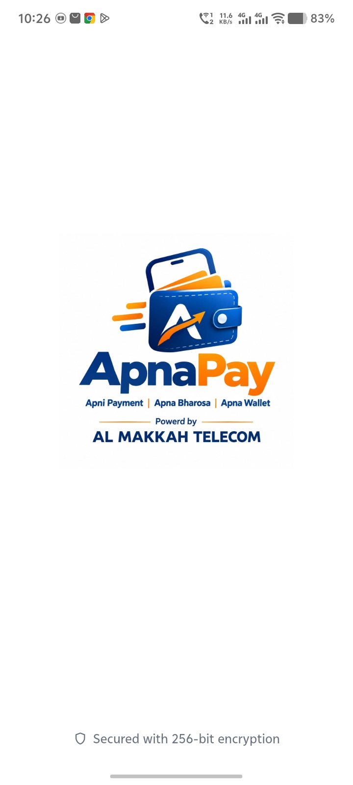 | 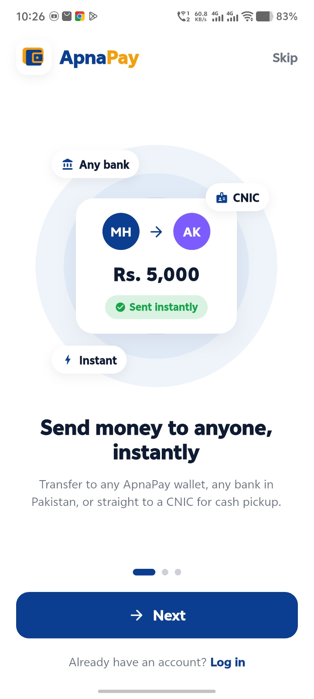 | 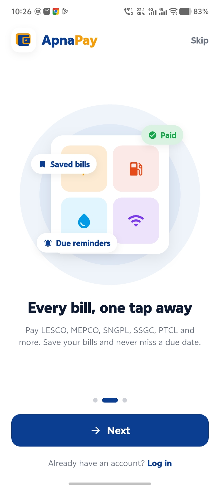 |

| 4 | 5 | 6 |
| --- | --- | --- |
| 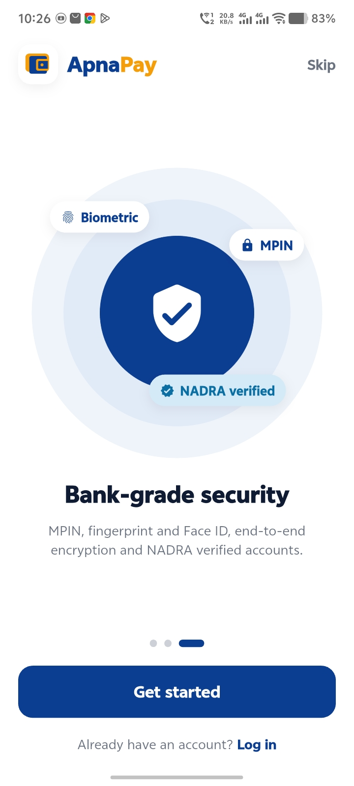 | 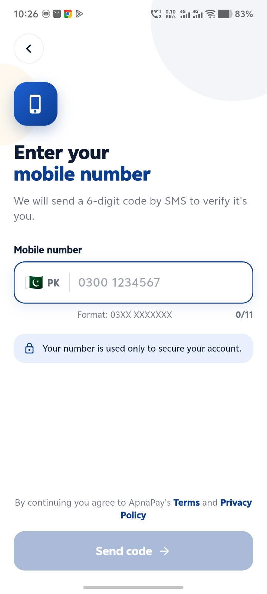 | 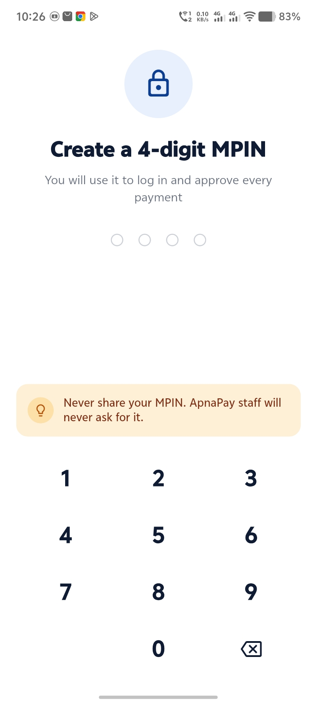 |

| 7 | 8 | 9 |
| --- | --- | --- |
| 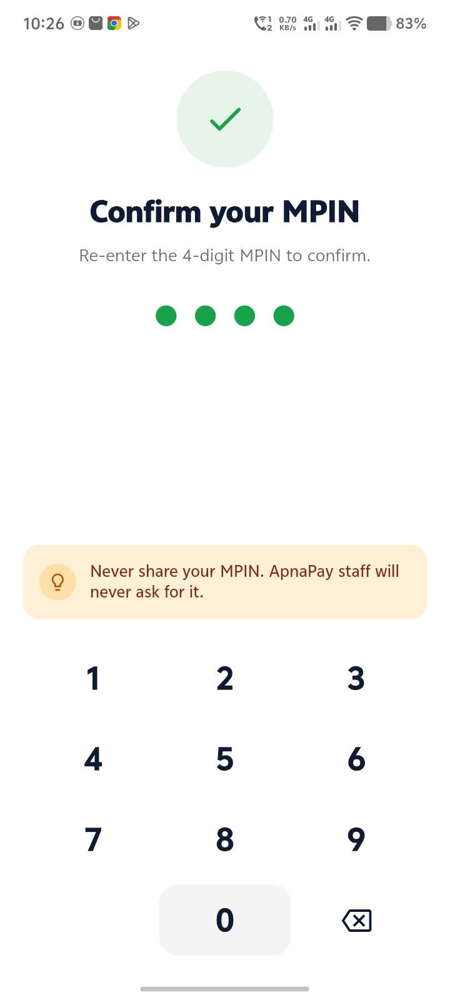 | 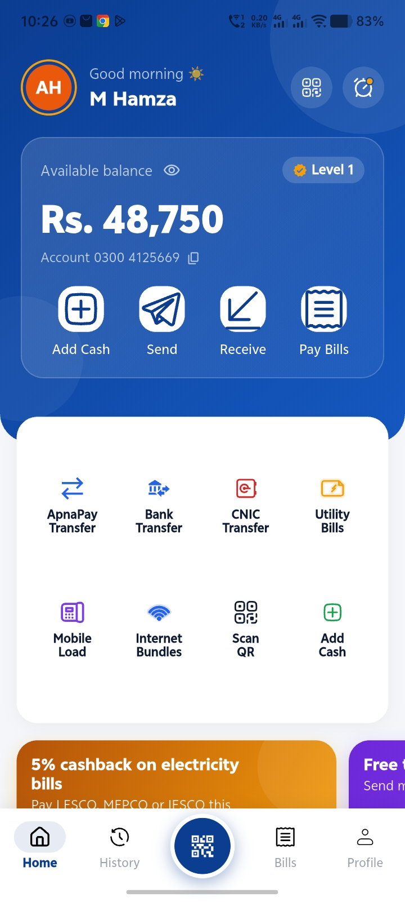 | 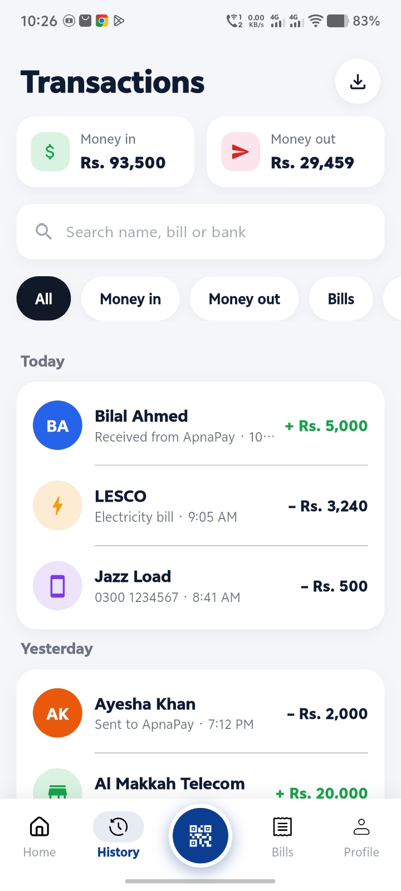 |

| 10 | 11 | 12 |
| --- | --- | --- |
| 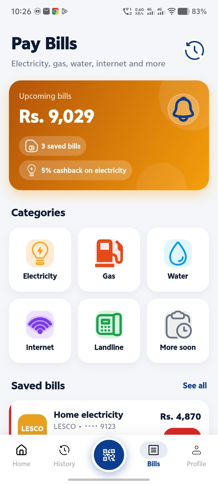 | 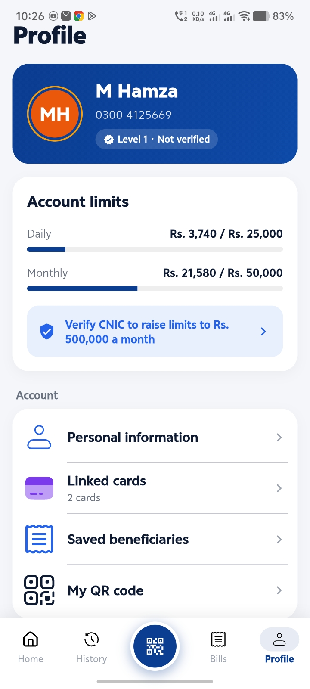 | 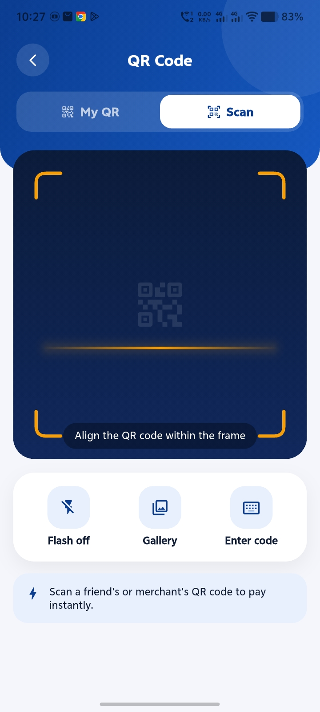 |

### 13


## Features

The repository contains Flutter screens and supporting components for:

- Splash, onboarding, phone-number entry, login, and MPIN
- Wallet home and profile
- ApnaPay and bank transfers
- Mobile load / top-up
- Utility bills, including electricity
- QR screen
- Transaction history
- Reusable navigation, keypad, input, and button widgets

## Built with

- [Flutter](https://flutter.dev/)
- Dart
- Material widgets

## Project structure

```text
lib/
├── constants/   # App assets, colors, and text styles
├── controllers/ # Navigation controller
├── data/        # Demo data for app screens and flows
├── screens/     # Onboarding, home, bills, history, QR, and profile screens
├── transfers/   # ApnaPay, bank transfer, and mobile load flows
└── widgets/     # Shared UI components

assets/          # SVG icons and image assets
android/         # Android platform project
 test/           # Flutter tests
```

## Getting started

### Prerequisites

- Flutter SDK installed and configured
- Android Studio or another supported Flutter IDE, or an Android device/emulator

Check your Flutter setup:

```bash
flutter doctor
```

### Run the app

Clone the repository, fetch dependencies, and run it on a connected device or emulator:

```bash
git clone https://github.com/hk994512/Apna-Pay.git
cd Apna-Pay
flutter pub get
flutter run
```

## Run tests

```bash
flutter test
```

## Notes

The numbered screenshots are stored in the repository root as `1.jpg` through `13.jpg`. If you add, remove, or rename screenshots, update the image links in this README to match.
